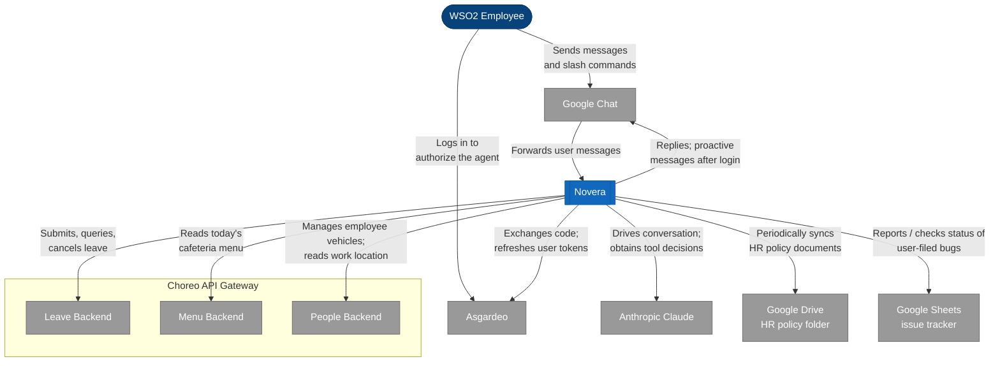
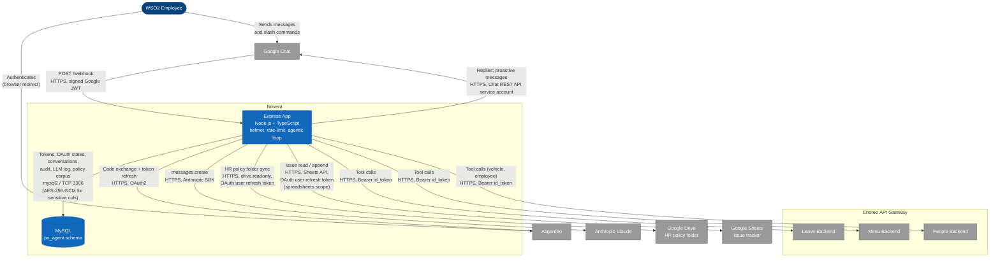
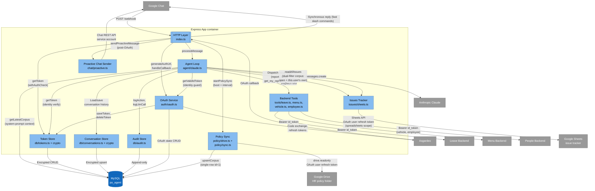
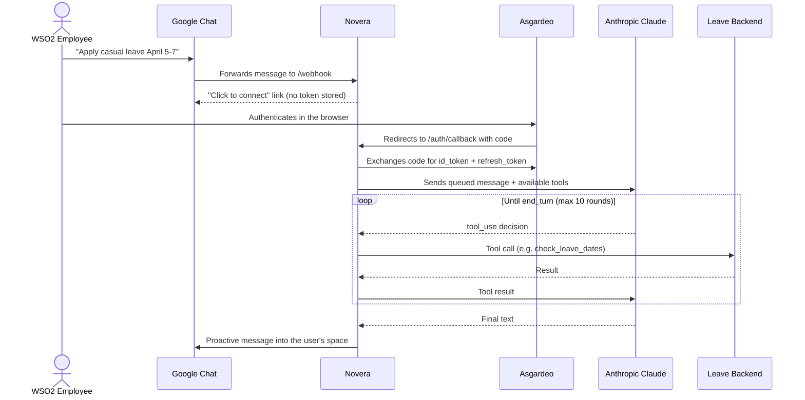
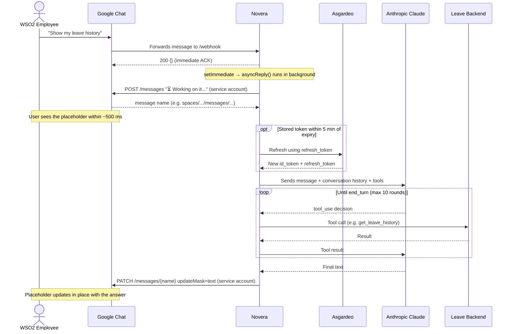

<!--
Copyright (c) 2026, WSO2 LLC. (https://www.wso2.com). All Rights Reserved.

This software is the property of WSO2 LLC. and its suppliers, if any.
Dissemination of any information or reproduction of any material contained
herein in any form is strictly forbidden, unless permitted by WSO2 expressly.
You may not alter or remove any copyright or other notice from copies of this content.
-->

# Novera — Architecture

A Google Chat-based AI agent that lets WSO2 employees handle PO tasks (leave) and workplace queries (menu) without leaving Chat. Phase 1 scope is leave management + menu lookup.

## System Context (C4 Level 1)

The zoomed-out view of what the agent is and the people + external systems it directly depends on. Protocols, containers, and internal storage are intentionally omitted — they belong in C4 Level 2 (Container) and below.

Drawn with Mermaid `flowchart` rather than `C4Context` — the C4 model is notation-independent, and Mermaid's flowchart renders reliably without the label-overlap issues of `C4Context`. C4 conventions are preserved through colour and shape: stadium for the person, double-bordered box for the in-scope system, plain boxes for external systems, and a subgraph for the Choreo boundary.

## Stack

- **Runtime**: Node.js 20, TypeScript (compiled with `tsc` → `dist/`)
- **LLM**: Anthropic Claude via `@anthropic-ai/sdk` (default `claude-sonnet-4-6`, overridable via `ANTHROPIC_MODEL`)
- **Web**: Express, helmet, express-rate-limit
- **HTTP client**: axios (backend service calls + OAuth token exchange)
- **Auth**: Asgardeo OAuth2 (auth-code flow) — `google-auth-library` for verifying Google Chat webhook JWTs
- **Storage**: MySQL (`po_agent` schema) via `mysql2`
- **Config**: `dotenv` (see `.env.example` for the required vars)
- **Build / dev**: `npm run build` → `dist/`, then `npm start` runs `node dist/index.js`; `npm run dev` runs via `ts-node` for fast iteration
- **Deploy**: Choreo (manifest at `.choreo/component.yaml`, OpenAPI at `.choreo/openapi.yaml`)
- **Package name**: `novera`

## Container Diagram (C4 Level 2)

Zooms inside the Novera boundary. The system runs as **two containers**: a single Node.js Express app and the MySQL schema it depends on. External systems are unchanged from L1; what's new at L2 is the addition of technology and protocol detail on every relationship (which the C4 model explicitly permits at this level).

### Container responsibilities

- **Express App** — the only running process. Hosts `/webhook` (Google Chat), `/auth/callback` (Asgardeo), and `/health`; runs the agentic loop against Claude; performs identity validation on every tool call; calls the Leave, Menu, and People backends through Choreo; periodically syncs the HR policy Drive folder; reads and writes all persistent state via mysql2.
- **MySQL (`po_agent`)** — six tables: OAuth states, encrypted user tokens, encrypted conversation history, audit log, LLM call observability, and the HR policy corpus. See the [Data model](#data-model-po_agent-mysql-schema) section for the schema. Sensitive columns are AES-256-GCM encrypted by the app before write.

### Why only two containers

There is intentionally no separate worker process, scheduler service, or admin UI. The agent's periodic housekeeping (`deleteStaleOAuthStates`, `deleteStaleConversations`, `runPolicySync`) runs inside the Express process via `setInterval`. The `purge_agent_llm_call_log` job runs inside MySQL itself as a server-side EVENT. Keeping everything in one Express container matches the Phase 1 footprint and the Choreo deployment model (`.choreo/component.yaml` declares a single REST endpoint).

## Component Diagram (C4 Level 3)

Zooms inside the **Express App** container from L2. The components map one-to-one to the `src/` directory layout. Cross-cutting helpers (`db/crypto.ts`, `db/client.ts`) are kept implicit — they are libraries used by components, not components themselves.

### Component responsibilities

| Component | File(s) | Responsibility |
|---|---|---|
| **HTTP Layer** | `src/index.ts` | Express setup, Helmet, global + per-user rate limits, Google JWT verification middleware, `/webhook` + `/auth/callback` + `/health` + `/internal/notifications` routing, slash-command dispatch, `withAuthCheck` gating, location-aware `/help`, startup-time `startPolicySync` boot |
| **Agent Loop** | `src/agent/claude.ts` | System prompt + tools registry, agentic loop (max 10 rounds), per-tool identity guard (`jwt.email === wso2_email`), tool dispatch, post-call audit, location-based tool/prompt gating, HR policy corpus injection with Anthropic prompt caching |
| **OAuth Service** | `src/auth/oauth.ts`, `src/auth/choreo.ts` | Asgardeo auth URL generation (with state row), code exchange, refresh with JWT-level expiry check, `invalid_grant` → token deletion, stale-state sweep. `choreo.ts` is a deliberate pass-through (Asgardeo is the key manager). |
| **Backend Tools** | `src/tools/leave.ts`, `src/tools/menu.ts`, `src/tools/vehicle.ts`, `src/tools/employee.ts` | Typed HTTP clients for Leave (6 ops), Menu (1 op), Vehicle (3 ops), and Employee (`getMyLocation`). All carry the id_token as Bearer; build query strings with `URLSearchParams` where repeated params are needed. Sanitize backend errors via `utils/log.ts` so raw response bodies never leak into logs or user replies |
| **Policy Sync** | `src/policy/drive.ts`, `src/policy/sync.ts`, `src/db/policy.ts` | Runs at startup and every `HR_POLICY_SYNC_INTERVAL_HOURS`. Lists the configured Drive folder via the user's OAuth refresh token (drive.readonly), extracts text from supported docs (Google Docs, plain text, PDF via `pdf-parse`, Word `.docx` via `mammoth`), concatenates with `=== Title ===` separators, and UPSERTs into `agent_policy_corpus` at `id = 1`. Unsupported MIME types (old `.doc`, Sheets, slides, subfolders) are skipped with a warning; PDFs that extract suspiciously little text (likely scans) trigger a separate warning. |
| **Issues Tracker** | `src/issues/sheets.ts` | Google Sheets-backed bug tracker. Auto-creates the header row on first write; assigns monotonically increasing `issue_id` values; exposes `readAllIssues()` (full snapshot, called once per chat turn and filtered app-side into the dedup corpus + this user's own filings — both injected into the system prompt so status answers don't echo stale assistant turns), `listOpenIssues()` / `getIssuesByReporter(email)` (kept for tool dispatchers), and `reportIssue({email, description})` (append, returns `{issueId}`). Reuses the HR-policy OAuth refresh token (same wso2.com user, scope upgraded to include `spreadsheets`). Fail-open on read: a Sheets outage falls back to empty corpora so the rest of the agent stays available. |
| **Proactive Chat Sender** | `src/chat/proactive.ts` | Service-account-backed POST to `chat.googleapis.com/v1/{space}/messages` — the only path to push a reply after the OAuth browser redirect closes the original webhook |
| **Notifications** | `src/chat/notify.ts` | Validates a notification from another internal service, builds its card (escaping every value), and sends it to every DM in `agent_dm_spaces` through the Proactive Chat Sender. See [Notifications](#notifications) |
| **DM Spaces** | `src/chat/dmSpaces.ts`, `src/db/dmSpaces.ts` | Keeps `agent_dm_spaces` current from webhook events: records a DM when Novera is added to one or gets a message in one, removes it when Novera is removed. Group spaces are never recorded |
| **Token Store** | `src/db/tokens.ts` + `src/db/crypto.ts` | Encrypted CRUD on `agent_user_tokens`. AES-256-GCM at boundary; failed decryption deletes the row to force clean re-auth |
| **Conversation Store** | `src/db/conversations.ts` + `src/db/crypto.ts` | Encrypted rolling-50 message history; sanitization on load/save to prevent orphaned `tool_result` blocks |
| **Audit Store** | `src/db/audit.ts` | Append-only writes to `agent_audit_log` (action + status + short message — **no payloads**) and `agent_llm_call_log` (per-round metadata) |

### Notable interactions

- **OAuth Service writes directly to MySQL** for `agent_oauth_states` rows — there is no dedicated "OAuth State Store" component because the rows are an implementation detail of the auth flow itself.
- **The Agent Loop touches both the Token Store and the OAuth Service** on every tool call. The Token Store gives the stored `wso2_email`; the OAuth Service gives a *valid* id_token (refreshing if needed). Both feed into the identity guard.
- **`crypto.ts` is shared** between Token Store and Conversation Store, but is not a component in its own right — it's a stateless helper, on par with `mysql2` itself.

## Dynamic View — first-time leave request

A runtime view of the most informative scenario: a new user (no stored token yet) sending their first leave request. Drawn as a sequence diagram rather than a C4 Dynamic diagram — the C4 model explicitly permits a UML sequence diagram for the dynamic view, and it renders far more cleanly here.

### Notes on the flow

- **Steps 1–3** are the synchronous webhook round-trip. The agent finds no stored token, persists the message + space name in `agent_oauth_states`, and returns the authorize URL inline.
- **Steps 4–6** are the OAuth dance. Because the browser redirect cannot deliver into the Chat space, the agent has to push the eventual reply back to Chat out-of-band — that is why a service account is required (step 11).
- **Steps 7–10** are the agentic loop. Each iteration is logged to `agent_llm_call_log` for observability. The loop terminates when Claude returns `end_turn`, or after `MAX_TOOL_ROUNDS = 10`.

## Dynamic View — returning user

The common case: a user who has already connected their WSO2 account. The Asgardeo dance is skipped entirely. **The agent uses an async-reply pattern** — the webhook is ACK'd immediately (so Google Chat / Cloudflare / Choreo don't retry on a slow LLM turn), a placeholder message is posted via the Chat API to give the user instant feedback, and the placeholder is updated in place with the real answer once the agent finishes processing.

### How this differs from the first-time flow

- **No OAuth round-trip.** The stored id_token is reused; the `opt` refresh path only runs if the token is within 5 minutes of expiry.
- **Reply path uses placeholder + in-place update** via the service account's Chat API access — the original `/webhook` HTTP request returns `200 {}` within ~50 ms, so there's no webhook-timeout pressure and no risk of Chat / edge layers retrying the slow path.

### Why the async-reply pattern

1. **Eliminates retry-induced duplicate replies.** The previous synchronous-webhook design could hold the HTTP connection open for 5-15 seconds on slow LLM turns; if Cloudflare / Choreo / Chat decided the upstream had stalled, they retried, both invocations ran in parallel, and two messages landed in chat. ACK'ing in ~50 ms removes the trigger.
2. **Gives the user feedback in under a second.** The placeholder appears via the proactive Chat API ~500 ms after they send the message, vs. several seconds of silence with the synchronous design.
3. **Cleanly supports multi-pod deployments.** Webhook is fast and stateless; only one pod ever handles a given message.

The pattern applies to slow paths (`/leave`, `/status`, free-form messages — all of which hit the agentic loop). Fast slash commands (`/help`, `/connect`, default) still reply synchronously since they complete in well under a second.
- **Conversation history is loaded** from `agent_conversations` and passed to Claude, so the model has prior context (rolling 50-message window).
- **If the refresh fails** (e.g. `invalid_grant`), the agent deletes the stored token and falls through to the first-time flow, prompting the user to reconnect.

## Authentication & authorization

### Asgardeo OAuth2

- On-demand: first user message triggers the auth flow; subsequent messages reuse the stored token until expiry.
- Scopes: `openid email groups offline_access`. `groups` is required because backends do role-based checks.
- State rows (`agent_oauth_states`) carry the user's pending message and Chat space, so the agent can resume the original request after the redirect dance.

### Bearer to backends

The user's **id_token** (not access_token) is sent as `Authorization: Bearer` to Choreo-managed APIs:

- The id_token is a JWT carrying `email` + `groups` claims; backends extract these.
- Asgardeo is the Choreo key manager, so the gateway validates Asgardeo-issued tokens natively. No RFC 8693 token exchange is needed — `auth/choreo.ts` is a deliberate pass-through.
- The Choreo gateway injects the token as `x-jwt-assertion` to the Ballerina backend.

### Token lifecycle

`getValidIdToken` (in `src/auth/oauth.ts`) refreshes when either:
- The stored `expiresAt` is within 5 minutes of now, or
- The id_token's own `exp` claim is within 5 minutes of now.

Asgardeo may not issue a new id_token on every refresh, so the JWT-level check guards against using a stale id_token even when the access_token is fresh.

On `invalid_grant` from refresh, the token row is deleted to force a clean reconnect.

### Identity guards (defense in depth)

The agent runs LLM-driven tool calls on behalf of an authenticated user. Because the LLM can be fed malicious instructions, hallucinate parameters, or be prompt-injected via free-form user text, guards are layered so every tool call acts only on the authenticated user's own data — even when individual layers fail.

| Threat | Where it's blocked | How |
|---|---|---|
| LLM-injected target email used to act on another user | `executeTool` (`agent/claude.ts`) | Tool functions never accept email from `input`. `wso2Email` is read from the **verified stored token record** keyed on the authenticated Google user ID. The LLM cannot supply or override it. |
| Token swap / refresh resolving to a different identity mid-session | `executeTool` per-call check | `extractEmailFromJwt(idToken).toLowerCase() === wso2Email.toLowerCase()`; mismatch → reject with `"Identity validation failed"` before any backend call |
| LLM-injected target ID (`leaveId`, `vehicleId`) belonging to another user | `executeTool` destructive-action switch cases | Pre-fetch the user's own list via `getPendingLeaves` / `getVehicles` (both backend-scoped to `wso2Email`), assert the ID is in the list, refuse and audit-log `BLOCKED` if not |
| Cross-user access at the network layer | Ballerina backends (`employees/{email}/...` services) | Backends return `403 Forbidden` if `userInfo.email != employeeEmail`. Independent of the agent — defense in depth so a guard regression in the agent doesn't immediately become exfiltration |
| Path injection through `wso2Email` in interpolated URLs | All tool URL construction | `encodeURIComponent(wso2Email)` on every email-bearing path segment |
| Audit blind spots after a tool call | `executeTool` per-case `logAction` | Every tool execution writes a row to `agent_audit_log` with `SUCCESS` / `FAILED` / `BLOCKED`. Never request/response payloads — only `action`, `response_status`, and a 500-char sanitized `response_message` (privacy refactor `564c353`) |

Each row is independently sufficient *most of the time*; defense in depth is what guarantees a single regression (a forgotten guard, a renamed column, a wrong route) doesn't immediately become a confidentiality breach. When adding a new tool, all six rows should be considered explicitly — see SECURITY.md's "Defenses that look right" for the do-not-remove list.

## Data model (`po_agent` MySQL schema)

| Table | Purpose | Notes |
|---|---|---|
| `agent_user_tokens` | One row per linked user | `access_token`, `id_token`, `refresh_token` all AES-256-GCM encrypted at rest |
| `agent_dm_spaces` | One row per DM between Novera and a person | Where [notifications](#notifications) go, connected or not. `google_user_id`, `display_name` and `email` come from Chat events; backfilled rows have no email until the person interacts |
| `agent_oauth_states` | Pending auth flows | Holds `original_message` + `space_name` so post-auth proactive reply can pick up where the user left off; rows older than `expires_at` are swept hourly |
| `agent_conversations` | Per-user chat history | AES-256-GCM encrypted; max 50 messages rolling; 30-day TTL on `last_activity` |
| `agent_audit_log` | One row per tool execution | `response_status` ∈ {SUCCESS, FAILED, BLOCKED}; `response_message` (≤ 500 chars) for error context only — tool inputs/outputs are NOT stored |
| `agent_llm_call_log` | One row per LLM round | Observability: `session_id`, `round`, `stop_reason`, `tools_called` (JSON), token counts, `duration_ms`; auto-purged after 30 days via the `purge_agent_llm_call_log` MySQL EVENT (needs `event_scheduler = ON`) |
| `agent_policy_corpus` | Single-row cache of the latest HR-policy corpus (`id = 1` always; UPSERT on each sync) | Stores the concatenated `=== Title ===` corpus, plus `doc_count`, `total_bytes`, `synced_at`. The Agent Loop reads the row via `getLatestCorpus()` and injects it into the system prompt with `cache_control: ephemeral` for prompt caching. Drive is the source of truth for history — to recover from a bad sync, `DELETE WHERE id = 1` and the next sync rebuilds the row. |

### Encryption (`src/db/crypto.ts`)

- AES-256-GCM with 96-bit IV.
- Key is 32 bytes hex-encoded in `TOKEN_ENCRYPTION_KEY` (64 hex chars).
- Storage format: `<iv_hex>:<authTag_hex>:<ciphertext_hex>`.
- `decrypt` returns `null` on any failure (wrong format, wrong key, corruption). Callers treat that as "stale/legacy data" and delete the row, forcing re-auth or starting a fresh conversation.

### Conversation sanitization

History is sanitized both on load and before save: any leading messages that aren't a plain-text user message (e.g., orphaned `tool_result` blocks left after trimming) are stripped. This guards against the Anthropic API's rejection of conversations that begin with an unbound tool_result.

## Tooling surface

The agent exposes 13 tools to Claude (`src/agent/claude.ts`):

| Tool | Backend | Notes |
|---|---|---|
| `submit_leave` | `LEAVE_BACKEND_URL` POST `/leaves` | Confirmation required (system prompt guideline 3) |
| `check_leave_dates` | GET `/user-calendar` | Called automatically when user provides dates (guideline 8) — surfaces holidays |
| `get_leave_history` | GET `/leaves?statuses=PENDING,APPROVED,CANCELLED&limit=20` | Read-only |
| `get_pending_leaves` | GET `/leaves?statuses=PENDING,APPROVED` | Read-only; also used to gate `cancel_leave` |
| `cancel_leave` | DELETE `/leaves/{id}` | Confirmation + ownership check required |
| `get_menu` | `MENU_BACKEND_URL` GET `/menu` | Read-only; called immediately without confirmation (guideline 13) |
| `add_vehicle` | `PEOPLE_BACKEND_URL` POST `/employees/{email}/vehicles` | Confirmation required. Backend validates Sri Lankan plate regex |
| `get_vehicles` | GET `/employees/{email}/vehicles` | Read-only; also used to gate `delete_vehicle` |
| `delete_vehicle` | DELETE `/employees/{email}/vehicles/{id}` | Confirmation + ownership check required (mirrors `cancel_leave` guard) |
| `get_my_location` | `PEOPLE_BACKEND_URL` GET `/user-info` → GET `/employees/{id}` | Read-only; two-call (resolves `employeeId` from JWT first, then fetches `workLocation`). Self-only via backend's `workEmail` self-check |
| `get_letter_request_form` | none (returns `LETTER_REQUEST_FORM_URL` env var + hardcoded letter-type list from `src/tools/letter.ts`) | Read-only; no backend call. The tool exists for audit-logging and so the model has a single deterministic source of truth for the form URL and supported letter types |
| `report_issue` | Google Sheets API `spreadsheets.values.append` on `ISSUES_SHEET_ID` | Confirmation + duplicate check required (model checks the open-issues corpus in its context first; calls this only for genuinely new issues). Returns the assigned `issue_id`. |
| `get_my_reported_issues` | Google Sheets API `spreadsheets.values.get` on `ISSUES_SHEET_ID`, filtered to rows where `reporter_email` matches the authenticated user | Read-only. Returns the user's own reports only (filtering happens app-side; the model has all rows in its context for dedup but is instructed to show only the user's own). |

### HR policy Q&A is not a tool

HR policy questions are answered without invoking any tool. The HR policy corpus is synced from a Google Drive folder by the **Policy Sync** component and stored in `agent_policy_corpus`. At every chat turn, the Agent Loop prepends the latest corpus to Claude's system prompt as a cacheable block (`cache_control: ephemeral`). The model is instructed to answer policy questions only from this corpus and to cite the source document title; if the answer isn't there, it must refuse rather than guess. See [docs/google-setup.md](./docs/google-setup.md) → "HR policy Drive ingestion" for the ops side.

### Location-based feature gating

Not every tool is offered to every employee. The Sri Lanka office hosts the cafeteria-menu and parking systems the backend integrates with, so menu/vehicle tools are gated on the user's `workLocation`:

| Group | Tools exposed | Detection |
|---|---|---|
| Sri Lanka employees (`workLocation == "Sri Lanka"`) | All 13 tools | `getMyLocation()` returns `"Sri Lanka"` (case-insensitive trim) |
| All other employees | 9 tools — `submit_leave`, `check_leave_dates`, `get_leave_history`, `get_pending_leaves`, `cancel_leave`, `get_my_location`, `get_letter_request_form`, `report_issue`, `get_my_reported_issues` | Default; also the conservative fall-back if the lookup fails. Issue tracking is global (not SL-only). |

`processMessage` (in `src/agent/claude.ts`) fetches `getMyLocation()` at the start of each turn and uses the result to choose:

- The `tools` array sent to Anthropic (`LEAVE_ONLY_TOOLS` is `TOOLS.filter(...)` against a hardcoded name set), and
- The system prompt — a separate non-Sri-Lanka variant drops menu/vehicle from "Available actions" and explicitly tells the model to refuse menu/vehicle requests with a location explanation.

The `/help` slash command and the post-OAuth welcome message do the same lookup (`resolveIsSriLanka` in `src/index.ts`) so the user-visible capability list matches what the model can actually do.

**Failure mode:** if the location lookup fails (people-app down, token expired, employee record has no location), the user gets the leave-only set. SL employees on a flaky people-app see degraded UX briefly, but no non-SL employee ever sees menu/vehicle. Defense-in-depth: even if a stale tool somehow leaks into a request, the backend `workEmail` self-check and Choreo subscription gating remain.

**Cost:** one `getMyLocation()` call per chat message (two HTTP hops to the people-app backend). This is unoptimised — future work could cache `workLocation` on the `agent_user_tokens` row at `/connect` time and refresh on token refresh.

## Slash commands

- `/leave [details]` (command id `1`) — start a leave application
- `/status` (id `3`) — show pending requests
- `/connect` (id `4`) — link WSO2 account
- `/help` (id `5`)

Command id `2` is intentionally unassigned.

## Proactive messaging

`src/chat/proactive.ts` exports these functions, all backed by the service account (`GOOGLE_SERVICE_ACCOUNT_KEY`):

| Function | API | Used for |
|---|---|---|
| `sendProactiveMessage(spaceName, text)` | `chat.googleapis.com/v1/{space}/messages` (POST) | Post-OAuth welcome message (browser redirect can't deliver to Chat), and fallback when a placeholder send fails |
| `postNotificationMessage(spaceName, card)` | `chat.googleapis.com/v1/{space}/messages` (POST) | One [notification](#notifications) card, one attempt. Returns whether it worked and whether a failure is worth retrying; the card's thread isn't recorded in `agent_known_threads` |
| `sendPlaceholderMessage(spaceName, text)` | `chat.googleapis.com/v1/{space}/messages` (POST) | Same POST shape as proactive, but returns the created message's resource name so it can be updated later. Used by the async-reply flow to post the "⏳ Working on it..." indicator. |
| `updateMessage(messageName, text)` | `chat.googleapis.com/v1/{space}/messages/{id}` (PATCH, `updateMask=text`) | Update an existing message in place — used by the async-reply flow to replace the placeholder with the real answer |

All of them share a single cached `GoogleAuth` client (lazy init, internal access-token caching) so a typical request burst makes one `accounts.google.com/o/oauth2/token` call and reuses the token until expiry.

See [docs/google-setup.md](./docs/google-setup.md) for why a Google Cloud Project and service account are required on the Google side, and how they relate to webhook JWT verification.

## Notifications

`POST /internal/notifications` lets another internal service send a card to everyone who has added Novera, in their DM with it. til-backend uses it to announce new "Today I Learned" entries.

- **Auth:** the Choreo gateway's subscription check only. The caller presents a client-credentials token from an application subscribed to Novera's API, so approving a subscription lets that application message every connected employee.
- **Recipients:** every row in `agent_dm_spaces`: everyone who has added Novera, whether or not they've connected their WSO2 account. Only people in WSO2's Workspace can install Novera (its Marketplace listing is private), and group spaces are never recorded. Existing DMs were backfilled once with `scripts/backfill-dm-spaces.mjs` (see RUNBOOK.md).
- **Refused without access:** if Novera can't get a Google token, the route answers `503` and sends nothing, so the caller knows the notification wasn't sent and can offer to send it again (til-backend leaves the entry "not sent" for a moderator to resend).
- **Delivery:** otherwise the route answers `202` at once, then sends one card per recipient in the background:
  - **Paced:** at most 10 in flight, about 20 a second. That keeps a broadcast under ~1,200 of Google's 3,000 message writes a minute per project, which Novera's normal replies share. 2,000 recipients take about 100 seconds.
  - **Retries:** a 429, a 5xx or no answer is retried up to 3 times (about 1 s, 2 s, then 4 s apart), honouring Google's `Retry-After`.
  - **Clean-up:** a 404 means the DM is gone, so it's removed from `agent_dm_spaces`. Other failures, such as a 403 admin restriction, are only counted.
  - **Access lost mid-way:** the same check runs again when the broadcast starts; if it fails then, Novera logs why and sends nothing.
  - **Logs:**
    - One line per DM that still failed or was removed, with its ids and the reason, e.g. `[notify] source=til failed spaces/AAAA users/1234 (403: …)`. No names or emails; look the ids up in `agent_dm_spaces`, or for a removed DM, find the person by their `users/` id. Every removed DM is listed, as its row is gone; failed ones at most 100 a broadcast, then `…and <n> more failed DMs`.
    - One summary per broadcast, `[notify] source=<source> sent=<n> failed=<n> retried=<n> removed=<n> in <s>s`, followed by the three most common failure reasons.
  - **Restarts:** a restart mid-broadcast loses the cards not yet sent.
- **Replies under a card:** cards aren't recorded in `agent_known_threads`, as a notification isn't a conversation. A reply under one is processed like any new message, so the first answer lands in the main chat, without the card as context.

| Field | Required | Shown as |
|---|---|---|
| `source` | yes | Not shown. 1–40 lowercase letters, digits or hyphens, e.g. `til`; used in logs and the card id |
| `title` | yes | Bold and in full (≤ 300 characters) |
| `subtitle` | no | One grey line under the title, cut to about 36 characters (≤ 300) |
| `body` | yes | Plain text, cut at a word boundary to about 3 lines (≤ 5000) |
| `link` | no | `{url, label}`, shown as "…label" after the body. http or https |
| `footer` | no | A grey line under a divider (≤ 300) |
| `imageUrl` | no | A full-width picture under the title. https, public: Chat fetches it |
| `button` | no | `{url, label}`, a button under the body. http or https |
| `iconUrl` | no | An icon beside the title. https only, and it must load without signing in |

Every value is plain text; Novera escapes it. Unknown fields, or a value that breaks these rules, get a `400` with `{error}`.

## Rate limiting

Three layered limiters protect the public endpoints:

- **Global limiter** — `1000 req/min` across all routes, mounted before `express.json()` and JWT verification so anonymous abuse is rejected cheaply (no body parsing, no JWT CPU cost).
- **Per-user webhook limiter** (`webhookUserRateLimit`) — `60 req/min` keyed on `chat.user.name` (the Google user ID). Mounted on `/webhook` **after** `verifyChatRequest` so an unauthenticated caller cannot spray spoofed user names to multiply their bucket allocation; the key is only set once the JWT has been verified as a real Google Chat request.
- **OAuth callback limiter** (`authCallbackRateLimit`) — `30 req/min` keyed on `req.ip` on `/auth/callback`. Bounds DB load on `agent_oauth_states` and Asgardeo token-exchange spend during state-spray attacks.

`X-Forwarded-For` handling is gated on the `TRUST_PROXY` env var (`config.trustProxy`): set `true` when deployed behind a trusted reverse proxy (Choreo, nginx, ALB) so the client IP is read from the header; leave `false` (default) for direct-exposure deployments so spoofed `X-Forwarded-For` headers cannot defeat the IP-keyed limits.

## Audit & privacy

The audit log intentionally does NOT store request/response payloads. Tool inputs and outputs would contain PII (leave dates, comments, balances), so only `action`, `response_status`, and a 500-char `response_message` (for error context) are kept. The `agent_llm_call_log` table similarly stores only metadata (tool names, token counts, durations) — not the prompts or responses themselves.

## Deployment

Choreo component manifest at `.choreo/component.yaml` exposes a single REST endpoint (`/`, port 3000, public visibility) with three paths in the OpenAPI spec:

- `POST /webhook` — Google Chat webhook (no gateway auth — Google Chat cannot present a Choreo subscription token; verification is done in-app via JWT audience check)
- `GET /auth/callback` — Asgardeo redirect target (no gateway auth — browser redirect)
- `GET /health` — health probe

The Dockerfile is two-stage (build → production), runs as non-root user `10014` per Choreo policy.

## Environment

See `.env.example`. Required at startup (app fails-fast if any `required()` var is missing):

- `ANTHROPIC_API_KEY`, optionally `ANTHROPIC_MODEL` (default `claude-sonnet-4-6`)
- `TOKEN_ENCRYPTION_KEY` (64 hex chars — generate with `node -e "console.log(require('crypto').randomBytes(32).toString('hex'))"`)
- `ASGARDEO_*` (client id/secret, auth + token endpoints, redirect URI)
- `DB_*` (host, port, user, password; `DB_NAME` defaults to `po_agent`, `DB_SSL=true` in production)
- `LEAVE_BACKEND_URL`, `MENU_BACKEND_URL`, `PEOPLE_BACKEND_URL` (Choreo gateway URLs from the Developer Portal — People backend is for vehicle + employee tools, including `getMyLocation`)
- `GOOGLE_CHAT_WEBHOOK_AUDIENCE` (the full public webhook URL)
- `GOOGLE_CHAT_WEBHOOK_CALLER_EMAIL` (exact Google-managed SA email that signs incoming webhook JWTs — see `docs/google-setup.md` → "Capturing the inbound webhook caller email")
- `GOOGLE_SERVICE_ACCOUNT_KEY` (full JSON contents of the service-account key, stringified — used for proactive Chat replies only; Drive/Sheets access uses the OAuth user token below since WSO2 Workspace policy blocks `*.iam.gserviceaccount.com` sharing)
- `HR_POLICY_DRIVE_FOLDER_ID` (folder ID of the Drive folder containing HR policy docs; folder must be shared with the wso2.com user whose OAuth refresh token is configured below)
- `HR_POLICY_GOOGLE_OAUTH_CLIENT_ID`, `HR_POLICY_GOOGLE_OAUTH_CLIENT_SECRET`, `HR_POLICY_GOOGLE_OAUTH_REFRESH_TOKEN` (OAuth credentials for the wso2.com user that the policy syncer and issues tracker authenticate as; refresh token must include both `drive.readonly` AND `spreadsheets` scopes — see `docs/google-setup.md` → "HR policy Drive ingestion" / "Issues sheet")
- `ISSUES_SHEET_ID` (Google Sheet ID of the user-reported issue tracker; share with the OAuth user above + the dev team)
- `LETTER_REQUEST_FORM_URL` (URL of the Google Form the PO Team uses to receive letter requests; differs per environment)

Optional:

- `TRUST_PROXY=true` (default `false`) — set to `true` on Choreo / any deployment behind a trusted reverse proxy so `X-Forwarded-For` is honored for IP-based rate limiting. Leave unset for direct-exposure deployments — otherwise an attacker can spoof IPs.
- `LOG_LEVEL=info|debug` (default `info`) — `debug` includes raw backend response bodies in error logs. Keep at `info` in production; HR data can leak otherwise.
- `HR_POLICY_SYNC_INTERVAL_HOURS` (default `24`) — how often the agent re-pulls policy docs from Drive.
- `ANTHROPIC_MODEL` override (default `claude-sonnet-4-6`).

## Scope boundaries

- **OPD claim submission was removed** (legacy code stripped in commit `454c86b`). All related artifacts — `tools/opd.ts`, `chat/attachments.ts`, `ChatAttachment` type, `OPD_BACKEND_URL`, receipt pre-upload — are gone. If OPD comes back, treat it as a new feature, not a resurrection.
- Each tool only ever acts on the authenticated user's own records. Cross-user actions are explicitly rejected by guideline 1 in the system prompt and by the identity guards in `executeTool`.
